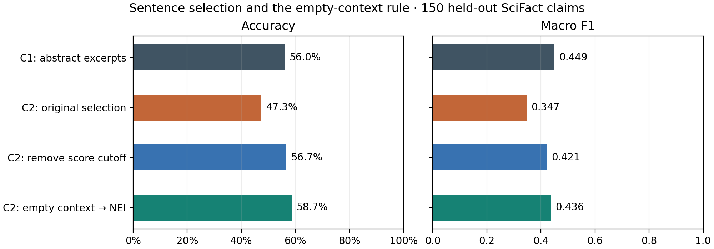

# 选句为什么有时会降低准确率

这里把“只保留选中的数据”理解为 C2：两组检索到同样的 8 篇摘要，C1 读带标题的摘要前部，C2 改读最多 4 条选中的句子。C2 的输入更短，也可能失去关键句、研究对象或前后文。

## 检查结果

逐条检查 300 条开发声明，C1/C2 的论文编号、顺序和检索分数一致；C2 的句子编号都能对回语料，并遵守每篇最多 2 句的限制。校准半组 C2 比 C1 多对 5 题，评估半组少对 13 题。评估半组中，91 题有标注证据，C1 在 81 题的实际输入中保留至少一组完整证据，C2 只有 48 题。C2 在整个开发集没有输出过 REFUTE。详见[配对审计](../outputs/tables/e2_selection_audit.md)和[逐题例子](SELECTION_CASES.zh.md)。

## 空证据规则

用原始 C2 的预测回放：选出 0 句时直接返回 NEI（所提供的证据不足），否则保留阅读模型的输出。复算不重新检索、不调用模型，也不改动原始 C2。空证据触发的判定是规则，输出里的 1.0 是规则权重，不能当作模型置信度。

| 固定比较 | 校准组正确 / 150 | 评估组正确 / 150 | 评估组宏平均 F1 |
|---|---:|---:|---:|
| C1，读摘要 | 74 | 84 | 0.449 |
| C2，读选句 | 79 | 71 | 0.347 |
| C2，空证据直接判 NEI | 86 | 88 | 0.436 |

评估组有 26 条空证据；规则改变了 19 条预测，纠正 18 条、改错 1 条，净增 17 条（+11.3 个百分点，配对 95% 区间 +6.0 到 +17.3）。规则后的准确率为 58.7%，宏平均 F1 仍低于 C1，也没有补回丢掉的证据或提升 REFUTE 识别。这是看到原始结果后做的诊断，不能视为新的独立测试集成绩。

用正式命令重新做了 GPU 推理。300 条标签、论文排序和选句均与缓存复算的输入和输出对应，50 条空上下文走了规则分支，留出组仍为 88/150。[真实推理验收](../outputs/tables/e2_empty_rule_live_validation.json)

可用缓存或真实推理复跑。按 [Windows 复跑说明](QUICKSTART.zh.md) 设置 Python 3.11 的 `$py`、准备 SciFact 数据，然后在仓库根目录执行：

```powershell
& $py scripts/13_audit_selection.py
& $py scripts/14_selection_study.py --empty-rule-only --out outputs/tables/e2_empty_rule
& $py scripts/04_run_condition.py --condition c2 --split dev --require-evidence --out outputs/predictions/c2_guard_dev.jsonl
```

## 选句参数对照

用同一批检索结果和同一个阅读模型，比较原规则、取消最低相关性分数（仍最多 4 句）、放宽到 8 句（每篇最多 4 句，并考虑摘要第 12 句以后的候选）和补邻句（保留原选句，再加同一摘要紧邻句，总计最多 8 句）。先在 150 条校准声明上比较宏平均 F1，然后只在另外 150 条上跑选中的方案和原规则。C2 与 C3 分开比较，避免把微调与选句的作用混在一起。

```powershell
& $py scripts/14_selection_study.py --condition c2 --out outputs/tables/e2_selection_c2
& $py scripts/14_selection_study.py --condition c3 --out outputs/tables/e2_selection_c3
```

`wide8` 同时改了候选范围和两种句数上限，因此只能比较整套策略。仅凭它的结果不能判断是哪一个参数起了作用。

原始 C2 用真实模型重跑，300 条标签与历史缓存完全一致。下面的选句方案在校准组比较，只有校准组宏平均 F1 最高的方案进入留出评估。这是原始结果已被查看后的复盘；该留出组不能当作新的独立测试集。

| C2 选句方式 | 校准组准确率 | 校准组宏平均 F1 | 留出准确率 | 留出宏平均 F1 |
|---|---:|---:|---:|---:|
| 原规则 | 52.7% | 0.391 | 47.3% | 0.347 |
| 取消最低分门槛 | 60.7% | 0.454 | 56.7% | 0.421 |
| 扩到 8 句 | 56.0% | 0.412 | — | — |
| 原选句加邻句 | 50.7% | 0.377 | — | — |

取消门槛在留出组比原 C2 多答对 14 条（+9.3 个百分点，配对 95% 区间 +3.3 到 +15.3），完整参考证据从 48/91 增至 52/91。取消门槛后，空上下文从 26 条降为 0，但其中也包含只给出低相关性句子的情况。空证据规则比取消门槛多答对 3 条，配对 95% 区间为 −2.0 到 +6.7 个百分点，差距还不确定。两种改动都单独记录，没有替换原配置。[C2 运行记录](../outputs/tables/e2_selection_c2.json)保存了校准组和留出组的指标。



C3 微调模型在校准组选择了 `wide8`（宏平均 F1：0.589，原规则 0.561）。留出组完整参考证据从 48/91 增至 62/91，但两组都答对 97/150（64.7%，配对差值 95% 区间 −3.3 到 +3.3 个百分点）。宏平均 F1 从 0.628 变为 0.623。没有足够证据说明这个改动能提高判定能力，C3 仍保留原配置。[C3 运行记录](../outputs/tables/e2_selection_c3.json)

另做了一项固定证据的提示对照：明确要求模型区分“讨论同一主题”和“有直接支持或反驳的证据”。校准组宏平均 F1 从 0.561 到 0.575，但留出组仍答对 97/150，NEI F1 仍为 0.565。这个改动没有解决 NEI 问题，原提示保留。[提示对照记录](../outputs/tables/e2_c3_sufficiency_prompt.json)

```powershell
& $py scripts/14_selection_study.py --condition c3 --clarify-evidence --out outputs/tables/e2_c3_sufficiency_prompt
```

## 英文报告表述

On the held-out SciFact development subset, replacing retrieved abstract excerpts with up to four selected sentences reduced accuracy from 56.0% to 47.3%. Document rankings were identical. Among the 91 claims with annotated evidence, the abstract condition presented at least one complete annotated evidence set for 81 claims; sentence selection reduced this number to 48. Some predictions remained incorrect even when a complete set was preserved, so the difference also reflects how the reader uses the available context.

The base reader sometimes predicted SUPPORT when no sentence passed the selector threshold. In a post-hoc replay, requiring an empty context to return NOT_ENOUGH_INFO raised held-out accuracy to 58.7%. This rule neither recovers missing evidence nor improves REFUTE detection. The guarded system still had lower macro-F1 than the abstract condition (0.436 vs. 0.449).
